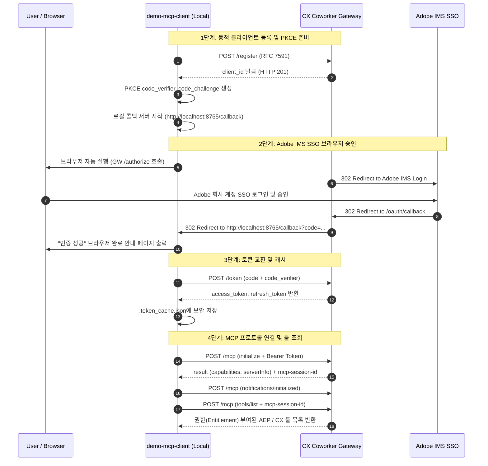

# CX Coworker Gateway MCP Client & Verification Tool

Adobe의 통합 MCP 게이트웨이인 **CX Coworker Gateway**(`https://cx-coworker-gateway.adobe.io`)에 직접 연결하여 **Adobe IMS SSO 웹 로그인 승인 및 MCP 도구 연동**을 검증하는 전용 MCP 클라이언트입니다.

---

## 📌 주요 기능 (Key Features)

1. **Adobe IMS SSO OAuth 2.0 PKCE 인증**:
   * **RFC 7591 Dynamic Client Registration**: 게이트웨이에 클라이언트를 동적 자동 등록
   * **PKCE S256 보호**: Secret 노출 없는 브라우저 기반 대화형 SSO 인증
   * **로컬 콜백 리스너**: `http://localhost:8765/callback`에서 인증 코드를 자동 수신하여 토큰 교환
   * **자동 토큰 갱신 및 캐싱**: `.token_cache.json`을 통해 만료 시간 관리 및 Refresh Token 갱신

2. **표준 MCP (Model Context Protocol) 2024-11-05 구현**:
   * **Initialize 핸드셰이크**: 프로토콜 버전 및 클라이언트 기능 협상
   * **세션 관리**: Gateway가 응답 헤더로 전달하는 `mcp-session-id`를 캡처하여 모든 후속 호출에 자동 전파
   * **Wide Route 지원**: `https://cx-coworker-gateway.adobe.io/mcp?manifest_id=public_cx_enterprise` (전사 솔루션 통합 카탈로그)
   * **Server-scoped Route 지원**: `https://cx-coworker-gateway.adobe.io/mcp/server/{server_id}` (예: `aep`, `target`, `cja`, `analytics` 등 특정 백엔드 직결)

---

## 🏗️ 아키텍처 및 인증/연동 시퀀스 (Authentication & MCP Flow)



---

## 🚀 빠른 시작 가이드 (Quick Start)

### 1. 원클릭 엔드투엔드 검증 실행 (`verify` / `test`)
인증 상태 확인 -> 필요 시 브라우저 SSO 팝업 -> 게이트웨이 핸드셰이크 -> 툴 목록 수집 및 솔루션별 분석 리포트를 원스톱으로 출력합니다:

```bash
cd /Users/jason/dev/ai-plugins/ao-agent-builder/demo-mcp-client
./run.sh verify
```

*(브라우저 창이 열리면 평소 사용하시는 Adobe IMS 회사 계정으로 로그인/승인하시면 됩니다.)*

---

### 2. 주요 CLI 명령어

#### A. 토큰 상태 및 유저 정보 확인
```bash
./run.sh status
```
* 토큰 만료 잔여 시간, 사용자 ID, 이메일, Org ID 표시

#### B. 명시적 Adobe SSO 로그인
```bash
./run.sh login
```
* 브라우저를 강제로 열어 새로 로그인하고 최신 토큰을 캐시합니다.

#### C. 사용 가능한 전체 툴 목록 상세 조회
```bash
# 전체 통합 카탈로그 (Wide Route)
./run.sh list-tools

# AEP 단독 직결 카탈로그 (Server-scoped Route)
./run.sh list-tools --server aep

# Target 단독 직결 카탈로그
./run.sh list-tools --server target
```

#### D. 특정 툴 실행 테스트
```bash
./run.sh call-tool <TOOL_NAME> --args '{"key": "value"}'
```

#### E. 캐시된 토큰 삭제 (로그아웃)
```bash
./run.sh logout
```

---

### 3. Claude Desktop 연동 (GitHub 저장소 직접 실행 - uvx)

Claude Desktop의 설정 파일(`~/Library/Application Support/Claude/claude_desktop_config.json`)에 아래와 같이 등록하면, 별도의 로컬 소스 의존 없이 GitHub에서 직접 최신 프록시를 실행합니다:

```json
{
  "mcpServers": {
    "cx-coworker-gateway": {
      "command": "uvx",
      "args": [
        "--from",
        "git+https://github.com/neep305/ao-mcp-client.git",
        "cx-mcp-proxy"
      ]
    }
  }
}
```

* **동작 원리**:
  1. Claude Desktop이 `uvx`를 통해 GitHub 저장소(`neep305/ao-mcp-client`)에서 패키지를 즉시 실행합니다.
  2. 토큰 및 세션 정보는 사용자 홈 디렉터리(`~/.ao-mcp-client/`)에 안전하게 저장 및 유지됩니다.
  3. 토큰 만료 시 백그라운드 리프레시를 통해 무중단으로 245개 Adobe 도구가 연결됩니다.

---

## 📂 프로젝트 구조

```
demo-mcp-client/
├── README.md               # 가이드 및 아키텍처 문서
├── requirements.txt        # 의존성 (httpx)
├── run.sh                  # 실행 래퍼 스크립트 (chmod +x)
├── .token_cache.json       # 발급된 Access/Refresh 토큰 (자동 생성, gitignore)
├── .client_cache.json      # 동적 등록된 Client ID (자동 생성, gitignore)
└── src/
    ├── __init__.py
    ├── oauth.py            # Dynamic Registration, PKCE S256, Local Callback Server
    ├── client.py           # Streamable HTTP MCP Client (Session 관리, Wide/Server 라우트)
    └── cli.py              # CLI 인터페이스 및 검증 테스트 로직
```

---

## 🔍 지원 솔루션 및 엔드포인트

| 솔루션 | 게이트웨이 엔드포인트 | 라우트 모드 |
|---|---|---|
| **전사 통합 (All CX)** | `https://cx-coworker-gateway.adobe.io/mcp?manifest_id=public_cx_enterprise` | Wide Route |
| **AEP (Experience Platform)** | `https://cx-coworker-gateway.adobe.io/mcp/server/aep` | Server-scoped |
| **Adobe Target** | `https://cx-coworker-gateway.adobe.io/mcp/server/target` | Server-scoped |
| **Adobe Analytics** | `https://cx-coworker-gateway.adobe.io/mcp/server/analytics` | Server-scoped |
| **Customer Journey Analytics (CJA)** | `https://cx-coworker-gateway.adobe.io/mcp/server/cja` | Server-scoped |
| **Adobe Journey Optimizer (AJO)** | `https://cx-coworker-gateway.adobe.io/mcp/server/ajo` | Server-scoped |
| **Marketo** | `https://cx-coworker-gateway.adobe.io/mcp/server/marketo` | Server-scoped |
